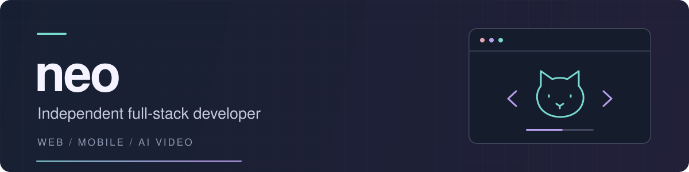

  

  <a href="https://www.solvin-apps.com/en/">Solvin Apps</a> &nbsp; / &nbsp;
  <a href="mailto:siyneo240803@gmail.com">Email</a> &nbsp; / &nbsp;
  <a href="https://github.com/neoAimeow?tab=repositories">Repositories</a>

I'm **Aimeow**, an independent full-stack developer focused on web and mobile development. Previously at **Alibaba**, **Meituan**, and **Creatify**.

My work spans frontend interfaces, iOS apps, backend services, and audio/video systems.

## What I build

- **Web applications** — React and TypeScript applications, reusable UI components, and interactive editors.
- **Mobile apps** — iOS, Flutter, and React Native applications, from implementation through release.
- **AI video tools** — At Creatify, I worked on video generation workflows, Remotion-based rendering, and a browser video editor.

## Toolkit

| Area | Technologies |
| --- | --- |
| Web | TypeScript, React, Tailwind CSS |
| Mobile | iOS, Flutter, React Native |
| Backend | Go, Rust, NestJS, Prisma, Java, Spring Boot, Spring Cloud |
| Video | Remotion, audio/video integrations |

## Get in touch

For project inquiries or collaboration, email **[siyneo240803@gmail.com](mailto:siyneo240803@gmail.com)**.

WeChat: `Yi-Yang-Buna` — please include a short introduction.

---

Away from the keyboard: piano, cats, aquascaping, and karting.
